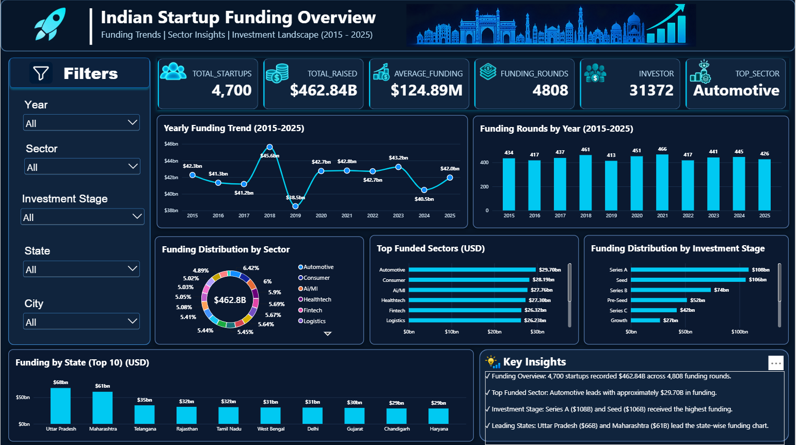
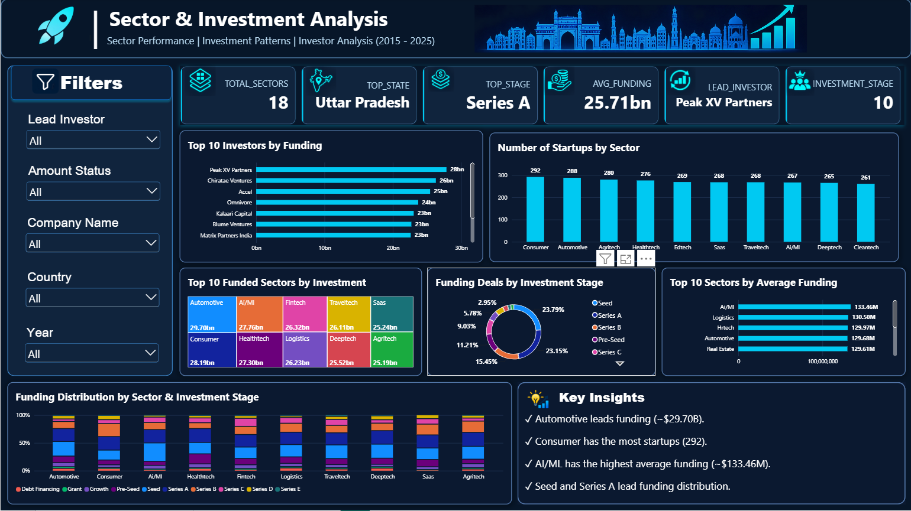

Indian Startup Funding Analysis (2015–2025)

An end-to-end data analytics project focused on analyzing Indian startup funding trends, investment patterns, sector performance, and investor activity using Microsoft Excel, SQL, and Power BI.

📌 Project Overview

This project explores Indian startup funding data from 2015 to 2025 to understand funding trends, identify leading sectors, analyze investment stages, and evaluate investor participation.

The project includes data preparation, data analysis, KPI development, and interactive Power BI dashboards to present meaningful business insights.

🎯 Project Objectives

✓ Analyze Indian startup funding trends from 2015 to 2025.

✓ Identify top-funded sectors and leading investors.

✓ Analyze funding distribution across investment stages.

✓ Compare startup activity across sectors and states.

✓ Identify investment patterns and business insights.

✓ Present findings through interactive Power BI dashboards.

🛠️ Tools & Technologies

- Microsoft Excel
- SQL
- Microsoft Power BI
- Power Query
- DAX
- Data Cleaning and Transformation
- Data Visualization

📊 Dashboard Features

1. Indian Startup Funding Overview

Key Performance Indicators:

- Total Startups: 4,700
- Total Funding Raised: $462.84B
- Average Funding: $124.89M
- Funding Rounds: 4,808
- Investors: 31,372
- Top Sector: Automotive

Visualizations:

- Yearly Funding Trend (2015–2025)
- Funding Rounds by Year
- Funding Distribution by Sector
- Top Funded Sectors
- Funding Distribution by Investment Stage
- Funding by State (Top 10)

2. Sector & Investment Analysis

Key Performance Indicators:

- Total Sectors: 18
- Top State: Uttar Pradesh
- Top Investment Stage: Series A
- Average Funding: 25.71bn
- Leading Investor: Peak XV Partners
- Investment Stages: 10

Visualizations:

- Top 10 Investors by Funding
- Number of Startups by Sector
- Top 10 Funded Sectors by Investment
- Funding Deals by Investment Stage
- Top 10 Sectors by Average Funding
- Funding Distribution by Sector & Investment Stage

🔍 Key Business Insights

Dashboard 1

✓ Total recorded startups: 4,700, with $462.84B in funding.

✓ Automotive is the leading funded sector.

✓ Series A and Seed are the leading investment stages.

✓ Uttar Pradesh and Maharashtra lead state-wise funding.

Dashboard 2

✓ Automotive leads sector funding at approximately $29.70B.

✓ Consumer has the highest startup count (292).

✓ AI/ML has the highest average funding (approximately $133.46M).

✓ Seed and Series A lead funding distribution.

✓ Peak XV Partners is the leading investor.

📁 Project Structure

Indian-Startup-Funding-Analysis/
│
├── Dataset/
│   └── Indian_Startup_Funding_Cleaned.csv
│
├── SQL/
│   └── Indian_Startup_Funding_SQL_Analysis.sql
│
├── Dashboard/
│   └── indian_startup_funding_analysis_dashboard.pbix
│
├── Dashboard_Previews/
│   ├── Dashboard_1.png
│   └── Dashboard_2.png
│
└── README.md

💡 Skills Demonstrated

Data Analysis

- Data exploration
- Trend analysis
- Sector analysis
- Investment analysis

SQL

- Data querying
- Filtering and aggregation
- Grouping and analysis

Power BI

- Data modeling
- Power Query
- DAX measures
- KPI development
- Interactive dashboards
- Business reporting

Core Analytical Skills

- Analytical thinking
- Problem solving
- Data interpretation
- Business intelligence

⚠️ Dataset Disclaimer

The dataset is used for educational and portfolio demonstration purposes. Any synthetic or simulated records are not real investment transactions. Please refer to the original dataset source for its data provenance.

👤 Author

Prithviraj Babar

GitHub: "Prithviraj Babar" (https://github.com/prithvirajbabarpatil)

🖼️ Dashboard Previews

## Dashboard Previews

### 1. Indian Startup Funding Overview

### 2. Sector & Investment Analysis

⭐ If you find this project useful, consider giving this repository a star!
